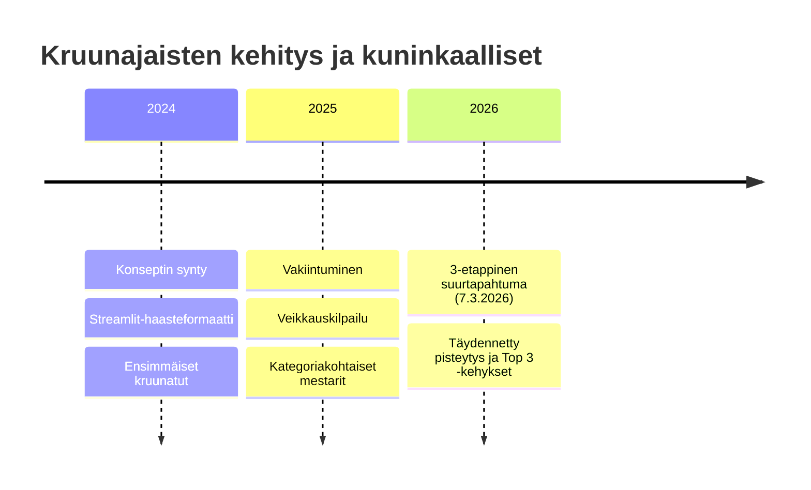

# Seuran Hall of Fame ja kausisaavutukset

Tälle sivulle kirjataan Ride Club Finlandin viralliset kausisaavutukset, seuramestaruudet ja historialliset merkkipaalut. Yksittäiset viikkotulokset kuuluvat Discordiin ja aineistovarastoon — tänne kootaan pysyvä kunnia.

---

## 1. Kruunajaiset — Seuran kevätmestaruus

Kruunajaiset on seuran perinteinen kevätkauden huipentuma, jossa ajajat ottavat mittaa toisistaan monietappisessa kisassa ja seuralle kruunataan vuosittaiset kuninkaalliset.

### Vuosittaiset kuninkaalliset ja mestarit:
- **Kruunajaiset 2026 (7.3.2026):**  
  Kolmen etapin kokonaiskilpailu. Kategoriakohtaiset voittajat ja top 3 -ajajat palkittiin seuran virallisilla profiilikehyksillä.
- **Kruunajaiset 2025:**  
  Tapahtuman vakiintuminen: mukana suosittu yhteisöveikkaus (Google Sheets -veikkauspisteet) ja jokerikisat.
- **Kruunajaiset 2024:**  
  Alkuperäinen konsepti, jossa ajettiin keskinäisiä kuskikohtaisia haasteajoja.

*(Tarkempi järjestämishistoria ja opit: [Kruunajaiset — tapahtumaplaybook](../TAPAHTUMAT/event_playbook_kruunajaiset.md))*

---

## 2. RCF Cup — Seuran talvisarja

RCF Cup on seuran oma moniosainen talvisarja, jonka kokonaispisteet lasketaan virallisesti ZwiftPowerin League -työkalulla.

- **Formaatti:** Useamman osakilpailun kokonaisuus, jossa kussakin kategoriassa (A, B, C, D) ajetaan tasaisista pisteistä.
- **Pysyvä tapahtumatagi Zwiftissä:** `zwift.com/uk/events/tag/rcfcup`
- **Palkitut:** Kunkin kategorian kokonaiskilpailun top 3 -ajajat palkitaan kauden päätteeksi seuran diplomeilla ja kunniamaininnoilla.

*(Tarkempi säännöstö ja pisteytysprosessi: [RCF Cup ja kilpailutoiminnan prosessi](../TAPAHTUMAT/competition_process_rcf_cup.md))*

---

## 3. Zwift Racing League (ZRL) — Liigajoukkueiden menestys

Ride Club Finland on yksi Pohjoismaiden aktiivisimmista ZRL-seuroista. Seura ilmoittaa jokaiseen WTRL:n liigakauteen useita joukkueita eri divisiooniin.

| Joukkue | Kategoria / Divisioona | Vakiintunut rooli | Merkittävät saavutukset |
|---|---|---|---|
| **RCF A1** | Cat A, Premier/Div 1 | Seuran lippulaivajoukkue | Divisioonan kärkitaistelut ja mitalisijat |
| **RCF A2** | Cat A, Divisioona 2 | Haastajaryhmä | Divisioonavoittoja ja nousuja kärkisarjaan |
| **RCF B1** | Cat B, Divisioona 1 | Kova kisaajaryhmä | Toistuvia podium- ja divisioonavoittoja |
| **RCF B2** | Cat B, Divisioona 2 | Laajan rintaman tiimi | Erinomaisia sijoituksia kovatasoisissa lähdöissä |
| **RCF C1 & C2** | Cat C, Divisioonat 1 & 2 | Yhteisövoiman ydin | Suuria starttimääriä ja tasaisia pistesijoja |
| **RCF D** | Cat D, Divisioona 1 | Matalan kynnyksen kilparyhmä | Divisioonavoittoja ja sarjanousuja |

- **Kausi 20 (Syksy 2026):** Seura osallistui ennätyksellisesti 7 joukkueen voimin. Kierroksella 4 joukkueet saavuttivat useita kärkikolmikkoja (mm. D-tiimin divisioonan ykkössija ja B2/A2-tiimien kakkossijat).
- **Kausi 19 (Kevät 2026):** Useita divisioonanousuja ja mitalisijoja.

---

## 4. Sunday Race Club (SRC, MyWhoosh)

Sunday Race Clubissa seura edustaa sinivalkoisia värejä kansainvälisessä MyWhoosh-sarjassa.

- **Syksy 2026:** Yhteensä kymmeniä suomalaisstartteja viikoittain.
- **Merkittäviä podium-sijoituksia:** Naisten Cat 2:n kakkossija (lokakuu 2026) sekä toistuvat pistesijat miesten kategorioissa 1–6.

---

## 5. Kansainväliset seuraottelut

### RCF vs SZR (Ruotsi)
Historiallinen ystävyysottelu ruotsalaista Szacke Ridersia (SZR) vastaan.
- Aika-ajot ja yhteislähdöt maiden välillä.
- Osoitti seuran kyvyn mobilisoida kymmeniä ajajia samalle linjalle suorassa verkkolähetyksessä.
- *(Tapahtuman playbook: [RCF vs SZR — tapahtumaplaybook](../TAPAHTUMAT/event_playbook_rcf_vs_sz.md))*

---

> [!NOTE] Tietosuoja ja nimikäytäntö
> Seuran Hall of Famessa noudatetaan P14-yksityisyyssääntöä: ajajista käytetään virallisia kisanimiä tai muotoa `E.Sukunimi`, ellei henkilökohtaista suostumusta (kuten Tomas) ole annettu.
