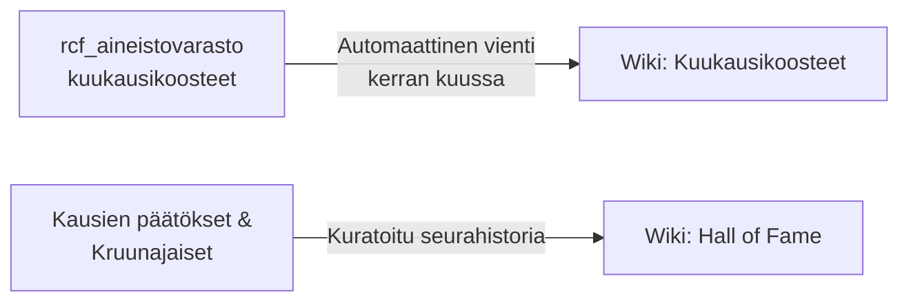

# Seuran historia ja kronikka

Tämä osio taltioi Ride Club Finlandin pysyvän historian, saavutukset ja yhteisön kasvun vuosi vuodelta.

---

## Wikin tallennusperiaate: Koosteet vs. viikkosälä

Wikin hengen mukaisesti ([ks. wiki-päätös](../meta/wiki_decision.md)) seuraamme selkeää linjaa:
- **Ei viikoittaista tulosvirtaa:** Yksittäiset kisasijoitukset, viikkojulisteet ja YouTube-tallenteet elävät Discordissa ja somessa.
- **Kyllä pysyvälle historialle:** Kausien kokonaissaavutukset, mestarit sekä kuukausittaiset koosteet siirretään wikiin pysyväksi muistiksi.

---

## Osion sisältö

1. **[Hall of Fame ja kausisaavutukset](hall_of_fame.md):**  
   Kruunajaisten kuninkaalliset, RCF Cupin mestarit, ZRL-liigan divisioonavoitot sekä seurojen välisten haasteotteluiden historia.
2. **[Kuukausikoosteet](kuukausikoosteet/2026-09.md):**  
   Seuran toiminnan kuukausikatsaukset (kohokohdat, starttimäärät, tavoittavuus ja yhteisön kasvu), jotka generoidaan suoraan aineistovarastosta.
