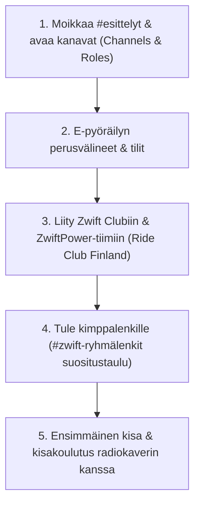

# Jäsenen FAQ ja onboarding-opas

Tämä on uuden tai palaavan jäsenen virallinen opas Ride Club Finlandiin: miten pääset mukaan, mitä välineitä ja tilejä tarvitset, miten viikko-ohjelma toimii ja mistä löydät apua matkan varrella.

---

## Mukaan pääsee monella tasolla

RCF:n toimintaan voi osallistua monella tasolla, eivätkä ne ole toistensa edellytyksiä:
- Voit seurata Discordia ja osallistua keskusteluun.
- Voit ajaa yhteisölenkkejä ja rentoja tapahtumia.
- Voit kokeilla e-pyöräilyä ja kilpailla seuran joukkueissa (Zwift ja MyWhoosh).
- Voit liittyä Ride Club Finland ry:n rekisteröityyn yhdistykseen ja edustaa seuraa virallisissa kilpailuissa ja lisenssitoiminnassa.

Valitse juuri ne osat, jotka sopivat sinulle parhaiten!

---

## Usein kysytyt kysymykset (FAQ)

### Paljonko osallistuminen tai jäsenyys maksaa?
- **Discord-yhteisöön ja virtuaalilenkeille osallistuminen on 100 % maksutonta.** Kaikki kimppalenkit, Discord-keskustelut, leikkimieliset kisat ja AI-palvelut ovat avoimia ilman jäsenmaksua.
- **Virallisen yhdistyksen (Ride Club Finland ry) jäsenyys:** Jäsenmaksu on **21 euroa / vuosi**. Maksu menee lähes kokonaisuudessaan Suomen Pyöräilyn (SP) seuramaksun kattamiseen. Yhdistyksen jäsenyys tuo virallisen edustusoikeuden kilpailuissa, Suomen Pyöräilyn lisenssimahdollisuuden sekä äänioikeuden seuran vuosikokouksissa.
- **Miten liityn viralliseen yhdistykseen?** Seuraan voi liittyä suoraan [SuomiSportin seuralinkillä](https://seurat.suomisport.fi/invite/3f4320bf-8675-4837-8406-3d6c5c5df290) tai seuran sivuston kautta ([rideclub.fi/liity-seuraan](https://www.rideclub.fi/liity-seuraan)). Kun ylläpito on manuaalisesti hyväksynyt liittymispyyntösi, 21 € jäsenmaksu maksetaan Suomisportin omalta tililtä löytyvästä *maksut*-osiosta.

---

### Mistä löydän tapahtumat ja viikkolukujärjestyksen?
> [!TIP] Automaattisesti päivittyvä viikko-ohjelma
> Viikkotapahtumat eivät elä vanhentuvana staattisena tekstinä, vaan **viikko-ohjelma päivittyy automaattisesti suoraan Discordiin**:

1. **Discordin Tapahtumat (Events):** Palvelimen yläreunan tapahtumalistaan synkronoituu automaattisesti viikon ajot peli- ja puhelinslinkkeineen.
2. **Kanava `#zwift-ryhmälenkit` (Dynaaminen kimppasuositus):** Kanavalla toimii päivittäin päivittyvä suositustaulu (Dynamic Card). Se poimii seuralaisille parhaan yhteislähdön ja kokoaa ajajat peukkureaktioilla (👍).
3. **Kanava `#ilmoitukset`:** Viralliset kausi- ja viikkotiedotteet sekä kisajulisteet.
4. **Sesh-tapahtumakalenteri verkossa:** Seuran koko tapahtumakalenteri löytyy suoraan osoitteesta [sesh.fyi/dashboard/1134843322695958570/events](https://sesh.fyi/dashboard/1134843322695958570/events?view=calendar). Tapahtumiin ilmoittaudutaan Discordissa Sesh-korttien reaktioilla: 👍 (varmasti mukana) tai ❓ (epävarma/varalla).

#### Viikon toistuva vakiorunko:
- **Tiistaisin klo 19–21:** **ZRL (Zwift Racing League)** — seuran liigajoukkueet kisaavat divisioonissaan.
- **Lauantaisin klo 9.00:** **Lauantaiaamun yhteisölenkki** — SZR Endurance -vierailulenkki Zwiftissä (rauhallinen PK-vauhti kaikille).
- **Lauantaisin klo 11.00:** **RCF Team Race** — seuran oma suosittu leikkimielinen joukkuekisa Zwiftissä (tiimijaot muodostetaan botilla Sesh-ilmoittautumisten pohjalta).
- **Sunnuntaisin:** **Sunday Race Club (SRC)** — MyWhoosh-alustan tiimikisat.
- **Arki-iltaisin:** Päivittäiset vapaat kimppalähdöt ja treenit, joita jäsenet sopivat kanavilla `#zwift-ryhmälenkit` ja `#harjoittelu`.

---

### Miksi Discord-kanavalistani on lyhyt? Miten saan muut kanavat näkyviin?
Seuran Discordissa kanavat on jaoteltu kiinnostuksen mukaan rooleihin, jotta jokaisen näkymä pysyy siistinä. Roolittomalle tulokkaalle näkyvät vain yleiset kanavat.
- **Avaa kanavat heti:** Klikkaa kanavalistan yläreunasta **Channels & Roles** (Kanavat ja roolit).
- Rastita aiheet, joista olet kiinnostunut: esim. **Zwift**, **MyWhoosh**, **Harjoittelu**, **Ulkoajo** ja oma **Paikkakuntasi**.
- Vastaavat kisa-, treeni- ja aluekanavat avautuvat heti näkyviin!

---

### Mitä tilejä tarvitsen?
- **Zwift-tili:** Perusajamiseen virtuaalimaailmoissa.
- **Zwift Club:** Avaa puhelimellasi **Zwift Companion** -sovellus, siirry **Clubs**-välilehdelle ja hae hakusanalla **Ride Club Finland**. Liity klubiin saadaksesi seuran omat eventit peliin!
- **ZwiftPower-tili:** Maksuton tili, jota tarvitaan Zwift-kisojen virallisiin tuloksiin ja kategorioihin. Liity seuran tiimiin [videon ohjeen](https://youtu.be/dVnWhcQfbJo) mukaan ja hae seuraa koko nimellä **Ride Club Finland**.
- **WTRL-tili:** Tarvitaan ZRL-liigaan ja tiimiaika-ajoihin. Luo tili osoitteessa [wtrl.racing/zrl](https://www.wtrl.racing/zrl/) ja linkitä se Zwift-tiliisi.
- **MyWhoosh-tili:** Jos ajat MyWhooshissa tai osallistut Sunday Race Clubiin ([mywhoosh.com](https://www.mywhoosh.com)).
- **Zwift-nimikäytäntö kisoissa:** Lisää Zwift-sukunimesi perään seuratunniste **[RCF]** (esim. *Matti Meikäläinen [RCF]*), jotta joukkuetoverit tunnistavat sinut kisoissa!

---

### Miten saan seuran virallisen Zwift-tiimipaidan hahmolleni?
Virtuaalinen RCF-ajoasu on ilmainen kaikille seuralaisille:
1. Liity ensin seuran Zwift Clubiin Companion-sovelluksessa.
2. Täytä ajoasulomake omalla Zwift ID:lläsi (löydät lomakkeen kanavan `#infopankki` kiinnitetyistä viesteistä tai kysymällä Tomaksen AI-apurilta DM:ssä).
3. Seuran tilausautomaatio toimittaa ID-numerot Zwiftille joka yö, ja ajoasu aktivoituu hahmosi autotalliin (Garage) automaattisesti.

---

### Mistä saan seuran oikeita ajovaatteita?
- Seuran viralliset laadukkaat **Moomoo-ajovaatteet** (ajopaidat, bibsit, takit, asusteet) tilataan keskitetyillä yhteistilauksilla.
- Tilausikkunoiden aukeamisesta ja sovituskappaleista tiedotetaan kanavalla `#seuravaatteet-moomoo`.
- *(Huom: Vanha Spreadshop-verkkokauppa on poistunut käytöstä.)*

---

### Miten puhekanavilla toimitaan? Onko mikrofoni pakollinen?
- Puhekanaville ovat **kaikki tervetulleita myös pelkästään kuuntelemaan!**
- Voit tulla mukaan lenkille tai kisaan pitäen mikrofonisi mykistettynä tai käyttäen push-to-talk -asetusta.
- Kuuntelemalla opit ryhmän dynamiikan ja kisoissa kuulet tärkeät taktiset huudot ilman minkäänlaista puhumispakkoa.
- Katso suositellut luujohdekuulokkeet, Krisp-taustamelunvaimennus ja PC-ruudunjako-ohjeet: **[Discord-ääni, laitteet ja striimaus](discord_aani_ja_striimausopas.md)**.

---

### Voiko seura tallentaa pelikuvaani koosteisiin ja someen?
Kyllä, jos haluat. Vastaa **Kanavat ja roolit** -näkymässä kysymykseen *"Saako kisoistasi tehdä klippejä?"*: **🏠 Kyllä, Discordiin** (vain seuran Discord), **🌍 Kyllä, myös someen** (lisäksi Instagram ja YouTube) ja/tai **🎙️ Puheeni saa käyttää** (puheesi klipissä äänenä tai tekstityksenä). Kun olet valinnut Kyllä, **RCF Kamera** tallentaa Go Live -jakosi puhekanavalla. Tallenne menee seuran videostudion Drive-kansioosi, josta videobotti tekee siitä koosteen tai highlightin. Valinnan voi muuttaa milloin tahansa: Kyllä-valinnan poisto lopettaa tallennuksen heti. Ohje: [Discord-äänichat ja striimaus](discord_aani_ja_striimausopas.md), luku 5.

### Miten saan videon kisastani?
Seuran **videostudio** tekee kisastasi koosteen ja highlight-klipit. Helpoin tapa: ota **Kanavat ja roolit** -näkymässä klippilupa (🏠 Kyllä, Discordiin tai 🌍 Kyllä, myös someen), jaa pelisi **Go Livella** puhekanavalla, niin **RCF Kamera** tallentaa sen automaattisesti. Avaa kisan jälkeen postaus foorumille `#videostudio`, liitä saman ajon FIT-tiedosto ja vastaa studion kysymyksiin napeilla. Voit myös tallentaa kisan itse millä tahansa ohjelmalla. Vaiheittain: **[Videostudio: näin saat videon kisastasi](ai_videostudio_ohje.md)**. Apua saat kanavalta `#kysy-apurilta`.

### Miten voin seurata seuran kisoja katsojana (Kisakatsomo)?
Seuran suljettuja kisoja (kuten Club Ladder tai ZRL) voi katsoa Zwiftissä livenä kisaajan ohjaamosta **Meetup + Fan view** -kikalla, vaikka et polkisi itse metriäkään! Katso ohje: **[Kisakatsomo ja Fan View -opas](zwift_kisakatsomo_ja_fan_view.md)**.

---

### Voinko tulla mukaan, vaikka en ole kovassa kunnossa?
Ehdottomasti kyllä. Seurassamme ajetaan kaikenlaisia vauhteja rauhallisista PK-kahvilalenkeistä aina kansainvälisen tason kisoihin. Ryhmälenkeillä pidetään porukka koossa, ja kisoissa kisaat aina omassa tasoluokassasi (A–D).

---

### Mistä kysyn apua?
- **Kanava `#kysy-apurilta`:** Kirjoita kysymyksesi kanavalle, niin AI-apuri vastaa siihen omassa ketjussa, ja aktiivit ja kapteenit tarkentavat tarvittaessa. Kysy rohkeasti mitä tahansa.
- **Aiheiden omat kanavat:** laitteet ja trainerit `#välineet`, Zwiftin alkuun pääseminen `#aloittelijat-ja-vähän-väsähtäneet`, Zwift yleisesti `#zwift`.
- **Yhteisökummi Tomas:** Tomas on seuran nimetty yhteisökummi ja joukkuekapteeni, johon saat yhteyden suoraan Discordissa (DM:llä tai kanavilla).
- **AI Domestique (24/7):** Voit kysyä suoraan yksityisviestillä tältä botilta milloin tahansa, ja saat vastauksen seuran virallisen tietopankin pohjalta.

---

### Kuka on Tomas ja miten häneen saa yhteyden?
Tomas on Ride Club Finlandin virallinen **yhteisökummi ja joukkuekapteeni** — aito ihminen ja kokenut seuralainen, johon voit aina ottaa yhteyttä matalalla kynnyksellä Discordissa (suoraan DM-viestillä tai kanavilla). Tomas auttaa mielellään alkuun, neuvoo ryhmäajoihin liittymisessä ja opastaa yhteisön tavoille.

---

### Tarjoaako seura henkilökohtaista valmennusta tai treeniohjelmia?
Seura ei tarjoa henkilökohtaista maksullista yksilövalmennusta, mutta kanavalla `#harjoittelu` sekä yhteisölenkeillä jaetaan runsaasti vertaistukea, kokemuksia ja treenivinkkejä. Kysymyksiä voi esittää rohkeasti myös `#kysy-apurilta`-kanavalla.

---

### Ovatko naiset ja kansainväliset ajajat tervetulleita? (Women & International riders)
Ehdottomasti kyllä! RCF toivottaa tervetulleeksi aivan kaikki pyöräilijät sukupuoleen, ikään, tasoon tai asuinpaikkaan katsomatta. Kansainvälisille ajajille on oma kanava `#english-lounge`, ja puhekanavilla sekä yhteisölenkeillä käytetään sujuvasti myös englantia aina tarvittaessa.

---

### Miten seura rahoittaa toimintansa?
Ride Club Finland on voittoa tavoittelematon urheiluyhteisö. Perustoiminta (Discord-yhteisö, ryhmälenkit, leikkimieliset kisat ja tekoälypalvelut) pyörii vapaaehtoisvoimin ja on jäsenille täysin maksutonta. Virallisen yhdistyksen (Ride Club Finland ry) hallinto- ja liittokuluja katetaan 21 €/vuosi jäsenmaksuilla, jotka kattavat mm. Suomen Pyöräilyn seuramaksun ja virallisen kilpailuedustuksen.

---

### Pyöriikö Zwift Apple TV:llä, iPadilla tai puhelimella?
Kyllä! Zwift ja MyWhoosh tukevat useita eri alustoja:
- **PC & Mac:** Parhaat grafiikat ja rajattomat kytkennät (Bluetooth ja ANT+ USB-tikulla).
- **Apple TV:** Erittäin helppo ja vakaa ratkaisu olohuoneeseen. Apple TV tukee suoraan kahta Bluetooth-laitetta (jos tarvitset enemmän laitteita kuten sykevyön, trainerin ja kadenssianturin, kytke ne Zwift Companion -puhelinsovelluksen siltatilan kautta).
- **iPad, iPhone & Android:** Peli pyörii sujuvasti suoraan mobiililaitteilla ja tableteilla Bluetooth-yhteydellä.

---

### Mikä on ANT+ vs Bluetooth ja kumpi kannattaa valita?
- **Bluetooth (BLE):** Nykyaikainen standardi, joka toimii suoraan lähes kaikilla laitteilla (puhelimet, tabletit, läppärit, Apple TV). Yhteys on nopea ja vakaa.
- **ANT+:** Erityisesti urheilulaitteiden radiostandardi. Se vaatii tietokoneeseen erillisen pienen ANT+ USB-donglen (n. 15–25 €). ANT+:n etuna on se, että useat sovellukset tai mittarit (esim. Garmin-ajotietokone ja tietokoneen Zwift) voivat lukea saman trainerin tehodataa samanaikaisesti ilman kanavarajoitusta.
- **Suositus:** Jos ajat tabletilla tai Apple TV:llä, käytä suoraa Bluetoothia. Jos ajat PC:llä ja Bluetooth pätkii, edullinen USB-jatkojohto ja ANT+-tikku trainerin viereen tuo 100 % häiriöttömän signaalin.

---

### Tarvitsenko tuulettimen tai suojamaton sisäpyöräilyyn?
- **Tehokas tuuletin on ehdottoman välttämätön:** Sisällä polkiessa luonnollinen ajoviima puuttuu täysin. Ilman tehokasta ilmavirtaa kehon lämpötila nousee rajusti, syke karkaa ja tehot romahtavat. Tavallinen pieni pöytätuuletin ei usein riitä, vaan suosittelemme lattialle sijoitettavaa lattiatuuletinta tai puhallinta.
- **Suojamatto:** Trainerin alle sijoitettava vedenkestävä suojamatto suojaa lattiaa hieltä ja vaimentaa samalla tärinää ja runkoääniä (erityisen tärkeää kerrostaloissa).
- **Hikituki ja pyyhe:** Suosittelemme pyyhettä tangolle suojaamaan pyörän laakereita ja ohjainkannatinta hien aiheuttamalta korroosiolta.

---

### Miten virtuaalimäet (Trainer Difficulty) kannattaa säätää?
Zwiftin asetusvalikosta löytyvä **Trainer Difficulty** on oletuksena 50 %:
- Se **ei hidasta tai nopeuta** vauhtiasi virtuaalimaailmassa – watti on aina watti!
- Se skaalaa nousukulman vastusta: 100 % asetuksella 10 % mäki tuntuu vastuksessa todelliselta 10 % jyrkkyydeltä ja vaatii tiheitä vaihteita. 50 % asetuksella 10 % mäki tuntuu vastuksessa kuin 5 % nousulta, jolloin vaihteet riittävät paremmin ilman että jalka sakkaa.
- Useimmat kisaajat ja harrastajat käyttävät 30–60 % asetusta tasaisen kadenssin ylläpitämiseksi.

---

### Voiko älytraineriin laittaa tavallisen maantiepyörän kiinni? Kuluttaako se pyörää?
- Kyllä! Tavallinen maantie-, gravel- tai hybridipyörä sopii älytraineriin erinomaisesti.
- Suoravetotrainereissa (direct drive) takakiekko irrotetaan ja pyörä kiinnitetään suoraan trainerin pakkaan omalla pikalinkulla tai läpiakselilla (adapterit toimitetaan trainerin mukana).
- Nykyaikainen traineriajo ei vaurioita tai väännä pyörän runkoa normaalissa ajossa. Ketjun ja rattaiden kuluminen on vähäisempää kuin ulkona, koska sisällä ei ole hiekkaa, kuraa tai sadetta.

---

### Miten löydän oman kilpailukategoriani (A, B, C vai D) ja ZRS-pisteeni?
- **Zwift Racing Score (ZRS):** Zwiftin virallinen suorituskykyasteikko (0–1000 pistettä), joka päivittyy automaattisesti kisatulostesi ja wattiesi perusteella.
- **Perinteiset kategoriat (W/kg):**
  - **A:** 4.0+ W/kg (tai ZRS huipputaso)
  - **B:** 3.20 – 3.99 W/kg
  - **C:** 2.50 – 3.19 W/kg
  - **D:** alle 2.50 W/kg (rento aloittelijataso)
- Rekisteröidy ilmaiseksi **ZwiftPoweriin** ([zwiftpower.com](https://www.zwiftpower.com)) ja liity seuran tiimiin hakemalla koko nimellä **Ride Club Finland** ([videon ohje](https://youtu.be/dVnWhcQfbJo)).
- **Tärkeää:** ZwiftPower näyttää W/kg-lukusi, kategoriasi ja ZRS-pisteesi vasta, kun olet ajanut muutaman Zwift-kisan. Pelkät lenkit ja treenit eivät riitä. Jos et ole vielä kisannut, profiilissa ei siis näy lukuja – aja pari matalan kynnyksen kisaa (esim. RCF-joukkuekisa lauantaisin), niin luokkasi määrittyy.
- Kisoissa ajat aina omassa tasoryhmässäsi!

---

### Miten aloitan kilpailemisen Zwiftissä? (Aloittelijan kisaopas)
- **Miksi mukaan?** Adrenaliiniryöppy, itsensä ylittäminen ja yhteisön tuki tekevät kisaamisesta aivan eri tason elämyksen verrattuna yksin ajamiseen!
- **Aloittelijan askeleet:**
  1. **Aloita ryhmäajoista:** Tutustu pelin vauhdinjakooon rennommissa yhteisölenkeissä ennen ensimmäistä kisaa.
  2. **Yhdistä sykemittari:** Sykevyö on virallisissa kisoissa ja tuloslistoilla lähes aina pakollinen vaatimus.
  3. **Kokeile avoimia kisoja:** Esimerkiksi *Zwift Monthly Races* tai matalan kynnyksen arkikisat ovat helppo tapa totutella starttikiihdytyksiin (startissa poljetaan aina kovaa ensimmäiset 30–60 sekuntia, jonka jälkeen tahti tasaantuu).
  4. **Rekisteröidy ZwiftPoweriin:** Liity seuran tiimiin hakemalla koko nimellä **Ride Club Finland**, jotta saat viralliset tulokset ja näet oman kehityksesi. W/kg ja kategoria ilmestyvät näkyviin parin kisan jälkeen.
  5. **Lisää seuran tunnus nimeesi:** Lisää `[RCF]` sukunimesi perään Zwift-profiilissasi (esim. `Matti Meikäläinen [RCF]`), niin seuralaiset ja kisan seuraajat tunnistavat sinut radalla!

---

### Miten pääsen mukaan tiistain ZRL-joukkueeseen (Zwift Racing League)?
**Zwift Racing League (ZRL)** on maailman suurin e-pyöräilysarja (yli 26 000 kuskia), ja Ride Club Finlandilla on tiimejä kaikissa vauhtiluokissa (A, B, C ja D). ZRL:ssä ajetaan tiistai-iltaisin pisteistä joukkueena (joukkueaika-ajot ja maantiekisat välikireineen).

**Uuden ZRL-kuskin askeleet järjestyksessä** (kapteenien käytäntö, päivitetty 23.10.2026). Tee kaikki heti, niin olet valmis, kun tulet ensimmäisen kerran tiistaina ajamaan. Vaiheet 2 ja 3 pitää tehdä tässä järjestyksessä, koska WTRL linkittyy Zwift-tiliisi ja kapteeni voi lähettää joukkuekutsun vasta sen jälkeen.

1. **Seuran ajoasu Zwiftiin:** katso ohje yltä kohdasta *Miten saan seuran virallisen Zwift-tiimipaidan hahmolleni?* (lomake on `#infopankki`-kanavan kiinnitetyissä viesteissä).
2. **ZwiftPower-tili ja seuran tagi:** luo tili osoitteessa [zwiftpower.com](https://www.zwiftpower.com), jos sinulla ei vielä ole sitä. Liity sitten seuran tiimiin [tämän videon](https://youtu.be/dVnWhcQfbJo) ohjeen mukaan. **Hae seuraa koko nimellä Ride Club Finland**, jotta löydät oikean tiimin ([RCF:n tiimisivu](https://www.zwiftpower.com/team.php?id=20561)).
3. **WTRL-tili, joka linkitetään Zwift-tiliin:** luo tili osoitteessa [wtrl.racing/zrl](https://www.wtrl.racing/zrl/) ja yhdistä se Zwift-tiliisi. Ilman tätä kapteeni ei voi lähettää sinulle joukkuekutsua.
4. **Tärkein: lisää itsesi kausitaulukkoon.** Kirjoita nimesi [ZRL-kisarosteriin](https://docs.google.com/spreadsheets/d/1BdurppRZvvWnlRyRDIOdSh_C_Cp-VoDD8twATDTTkGk/) sen joukkueen kohdalle, johon kuulut tasosi mukaan. Taulukon avulla kapteenit näkevät, kuka pääsee mihinkin kisaan.
5. **Hyväksy joukkuekutsu ja ilmoittaudu:** kun kapteeni on lähettänyt kutsun, hyväksy se WTRL:ssä. Merkitse osallistumisesi kisaviikon Sesh-tapahtumaan (👍 mukana, ❓ epävarma tai varalla) ja tee virallinen ilmoittautuminen kapteenin jakamalla **Race Pass** -linkillä.
6. **Tiistaina:** lisää `[RCF]` Zwift-sukunimesi perään ja pue seuran ajoasu. Kokoonnumme Discordin kisaradioon taktiikkapalaveriin noin 15–30 minuuttia ennen lähtöä.

*Vinkki:* jos et ole vielä kisannut Zwiftissä, aja ensin pari tavallista kisaa. Niiden jälkeen kategoriasi ja ZRS-pisteesi näkyvät ZwiftPowerissa, ja kapteenin on helpompi sijoittaa sinut oikeaan joukkueeseen. **Missä ZRL:stä puhutaan:** jos tiedät jo vauhtikategoriasi, kysy ja ilmoittaudu oman kategoriasi kanavalla `#zrl-kategoria-a`, `#zrl-kategoria-b`, `#zrl-kategoria-c` tai `#zrl-kategoria-d`, jossa joukkueen kapteeni jakaa kutsut ja Race Pass -linkit. Jos et vielä tiedä kategoriaasi, kysy kanavalla `#zwift`. (`#rcf-joukkuekisat` on lauantain RCF Team Race -joukkuekisan kanava, ei ZRL:n.)

---

### Järjestääkö RCF toimintaa ja yhteislenkkejä ulkona kesällä?
- **Kyllä!** Vaikka talvikaudella keskitymme e-pyöräilyyn, keväällä ja kesällä toiminta siirtyy tielle ja gravelille.
- Jäsenet järjestävät paikallisia kimppalenkkejä (esim. PK-kahvilalenkit, maantietreenit ja soratielenkit) sekä osallistuvat yhdessä suuriin pyöräilytapahtumiin (kuten Saimaa Cycle Tour, Pirkan Pyöräily ja Tour de Helsinki).
- Valitse kanavalistan yläreunan **Channels & Roles** -valikosta oma paikkakuntasi, niin näet oman lähialueesi lenkkikanavat!

---

### Voinko synkronoida Zwift-ajot automaattisesti Stravaan ja Garminiin?
Kyllä, synkronointi toimii täysin automaattisesti:
1. Kirjaudu selaimessa osoitteeseen [zwift.com](https://www.zwift.com) ja avaa omat profiiliasetuksesi (*Settings -> Connections*).
2. Yhdistä tilisi **Stravaan**, **Garmin Connectiin** tai **TrainingPeaksiin**.
3. Jatkossa jokainen ajamasi lenkki ja kisa siirtyy suoraan mittari- ja harjoituspalveluihisi sekunneissa kisan päättymisen jälkeen!

---

### Miten teen ensimmäisen FTP-testin turvallisesti?
- Suosittelemme aloittelijalle Zwiftin **Ramp Testiä** (löytyy pelin *Workouts -> FTP Tests* -valikosta).
- Ramp Test kestää vain 15–20 minuuttia. Vastus nousee automaattisesti 1 minuutin välein aina uupumukseen saakka. Sinun ei tarvitse tietää tehojasi ennakkoon eikä säästellä vauhtia – poljet vain tasaista kadenssia (85–95 rpm) niin pitkään kuin jaksat!
- Peli laskee uuden FTP-arvosi automaattisesti heti testin päättyessä.

---

### Voinko kuulua toiseen pyöräilyseuraan ja ajaa silti RCF:n mukana?
Ehdottomasti kyllä! Ride Club Finland on avoin pyöräily-yhteisö. Monet jäsenistämme edustavat paikallista maantieseuraa ja ajavat RCF:ssä virtuaaliajoja ja kimppalenkkejä talvikaudella. Discord, kimppalenkit ja seuran omat kisat ovat avoimia kaikille. Virallinen RCF ry:n yhdistysjäsenyys (21 €/vuosi) tarvitaan vain, jos haluat nimetä RCF:n viralliseksi edustusseuraksesi Suomen Pyöräilyn virallisissa kilpailuissa.

---

### Miten ryhmäajot toimivat? Odotetaanko hitaimpia ja miten peesi (drafting) toimii?
- **Ketään ei jätetä yksin:** Seuran virallisilla yhteisölenkeillä (esim. lauantain klo 9 SZR-vierailu ja seuran omat kimppalenkit) pidetään porukka koossa. Monissa seuran yhteisöajoissa käytetään Zwiftin *Keep Together* (kumilanka) -asetusta, jolloin kaikki pysyvät tiiviisti samassa nipussa polkijan henkilökohtaisesta tehosta riippumatta!
- **Peesihyöty (Drafting):** Virtuaalipyöräilyssä peesiefekti on merkittävä: toisen takana tai ryhmän keskellä ajaessasi säästät **jopa 25–35 % tehoa** verrattuna yksin ajamiseen samalla vauhdilla. Pidä vain tasainen kadenssi ja pysy ryhmän sisällä.
- **Discord-puhekanava:** Tule rohkeasti mukaan puhekanavalle lenkin ajaksi (vaikka pelkästään kuuntelemaan) – puheessa sovitaan vauhti ja kokeneet kuskit huutavat tarvittaessa peesiapua putoaville!

---

### Toimiiko vanha rengasvetoinen traineri? Tarvitsenko erillisiä wattipolkimia?
- **Rengasvetoinen traineri (wheel-on):** Toimii täysin riittävästi aloitukseen ja yhteisölenkeille! Muista vain tarkistaa renkaan ilmanpaineet (n. 7–8 bar) säännöllisesti ja säätää rullan puristuspaine oikeaksi.
- **Suoravetotraineri (direct drive):** Suosittelemme sitä pitemmällä tähtäimellä kisaamiseen, sillä se poistaa renkaan luiston, on lähes äänetön ja mittaa tehon tarkasti (+/- 1–2 %).
- **Wattipolkimia ei tarvita:** Älytrainerin oma sisäänrakennettu tehonmittaus riittää kaikkeen seuran toimintaan ja kisalohkoihin B–D. Vain korkeimmassa ZRL A-divisioonassa kilpailevat käyttävät erillistä toissijaista tehonmittausta (dual recording).
- **Miksi kalibrointi (spindown) tehdään?** Kalibrointi varmistaa, että trainerin ilmoittamat watit pysyvät vakaina lämpötilan ja hihnakireyden muuttuessa. Tee spindown trainerin omalla sovelluksella noin kerran kuukaudessa 10 min lämmittelyn jälkeen.

---

### Miten MyWhoosh eroaa Zwiftistä? Onko teillä toimintaa Rouvyssa tai IndieVelossa?
- **Zwift:** Seuran suurin ja aktiivisin pääalusta (ZRL-tiimiliiga tiistaisin, Team Race lauantaisin ja päivittäiset kimppalenkit).
- **MyWhoosh:** Täysin maksuton huipputason virtuaalipyöräilyalusta, jossa ajetaan mm. sunnuntaisin virallista **Sunday Race Club (SRC)** -tiimikisaa suomalaistiimien kesken. MyWhoosh hyödyntää Unreal Engine -grafiikkamoottoria, joten se vaatii laitteelta hieman enemmän tehoa kuin Zwift.
- **Muut alustat (Rouvy, IndieVelo):** Seuralla ei tällä hetkellä ole virallisia sarjajoukkueita Rouvyssa, mutta jäsenet keskustelevat ja jakavat vinkkejä kanavalla `#yleinen`.

---

### Onko seurassa ikärajaa tai junioritoimintaa? (Can teenagers join?)
- **Nuoret ja perheet ovat lämpimästi tervetulleita!** Seurassamme ei ole tiukkaa alaikärajaa yhteisölenkeille.
- Zwift tarjoaa alle 16-vuotiaille lapsille ja nuorille **maksuttoman Zwift-tilin** vanhemman suostumuksella (haetaan Zwiftin verkkosivuilta).
- Suosittelemme, että alaikäisen huoltaja on mukana seuran Discordissa ja opastaa nuorta laitteiden ja nettiyhteyksien käytössä.

---

### Miten palautumista ja harjoitusrasitusta kannattaa seurata talvella?
- Kanavalla `#harjoittelu` seuralaiset jakavat parhaita treenimenetelmiä ja kokemuksia.
- Suosittelemme erityisesti maksutonta **Intervals.icu** -palvelua, joka lukee harjoitusdatasi automaattisesti Stravasta ja näyttää kunnon kehityksen (Fitness / Form / Fatigue) ja auttaa välttämään ylirasitusta talvikauden kovissa virtuaalikisoissa.
- Kysy rohkeasti vinkkejä treenikanavalta – yhteisössämme on kymmeniä kokeneita kuntoilijoita ja kilpapyöräilijöitä!

---

## Askel askeleelta: näin pääset alkuun

1. **Tule moikkaamaan kanavalle `#esittelyt` ja personoi kanavasi:**  
   Esittele itsesi matalalla kynnyksellä – kerro mistä päin ajat tai mikä pyöräilyssä innostaa. Valitse sen jälkeen kanavalistan yläreunan **Channels & Roles** -valikosta omat lajisi ja paikkakuntasi, jolloin kaikki vastaavat kanavat avautuvat.

2. **Tarkista välineet ja tilit:**  
   Tarvitset pyörän, harjoitusvastuksen/älytrainerin ja laitteen sovellukselle (PC, Mac, Apple TV tai tabletti). Suosittelemme myös sykemittaria, riittävän tehokasta tuuletinta ja suojamattoa trainerin alle. Rengasvetoisessa trainerissa (wheel-on) muista tarkistaa säännöllisesti rengaspaineet, ja suoravetoisessa trainerissa tehdä ajoittain kalibrointi (spindown).

3. **Liity seuran tiimeihin:**  
   - Zwift Companion: Etsi ja liity klubiin **Ride Club Finland**.
   - ZwiftPower: liity seuran tiimiin hakemalla koko nimellä **Ride Club Finland** ([videon ohje](https://youtu.be/dVnWhcQfbJo)).
   - Lunasta maksuton virtuaalinen RCF-tiimipaita infopankin lomakkeella.

4. **Tule mukaan ryhmälenkille:**  
   Tarkista päivän yhteislähtö kanavan `#zwift-ryhmälenkit` päivittäiseltä suositustaululta. Klikkaa peukku (👍) ja hyppää kyytiin puhekanavalle ajon ajaksi!

5. **Aja ensimmäinen kisa – pyydä kokenutta radiokaveriksi:**  
   Ensimmäinen kisa saa olla puhdas kokeilu. Suosittelemme lämpimästi seuran **kisakoulutusta**: pyydä kokenutta kuskia radiolle mukaan ensimmäiseen kisaasi `#zwift`-kanavalla. Kokenut kuski neuvoo suorana puheessa, missä kohtaa säästellä voimia, miten peesissä pysytään ja miten tehot jaksotetaan mäkiin!

---

Lisää ulkoisia analytiikka- ja harjoitustyökaluja: [E-pyöräilyn työkalulinkit](e_pyorailyn_tyokalulinkit.md).
