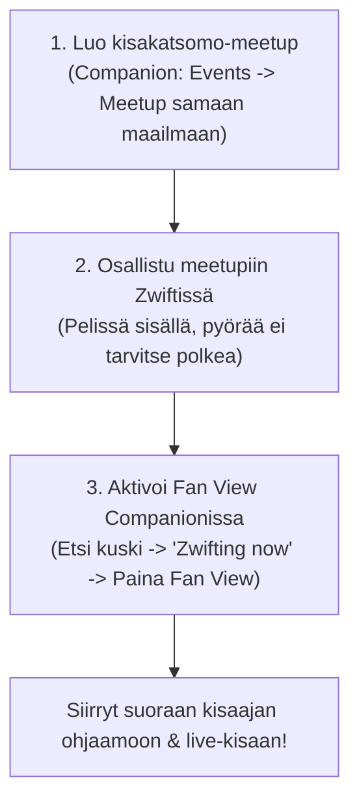

# Kisakatsomo ja Fan View — Näin seuraat seuran kisoja Zwiftissä

Kisakatsomoa ja Fan View -ominaisuutta käytetään silloin, kun halutaan seurata seuran suljettuja kisoja (kuten Club Ladder -kilpailuja tai ZRL-liigalähtöjä), joihin ei itse osallistuta polkemalla kilpaa.

Koska suljetuissa kisalähdöissä ei saa olla kisan ulkopuolisia ajajia radalla, kisakatsomo toteutetaan nerokkaalla **Meetup + Fan View** -yhdistelmällä.

---

## 3-vaiheinen katsomo-ohje

---

### Vaihe 1: Meetupin luonti
> [!NOTE] Seuran valmis kisakatsomo
> Jos RCF Clubilla on jo kalenterissa valmis virallinen kisakatsomo-event, liity suoraan siihen ja siirry Vaiheeseen 2!

1. Avaa **Zwift Companion** -sovellus puhelimellasi ja siirry **Events** $\rightarrow$ **Create Meetup** ([Zwiftin virallinen meetup-ohje](https://support.zwift.com/meetups-HJP7iUd4r)).
2. **Valitse sama ajomaailma:** Tee meetup samaan pelimaailmaan, jossa kisa ajetaan (esim. Watopia, Crit City, London). Meetupin reitillä ei ole väliä.
3. **Kutsu vähintään yksi kaveri:** Kutsu meetupiin kuka tahansa seuraamasi henkilö. Tämän henkilön ei tarvitse oikeasti osallistua – kutsu tarvitaan vain meetup-tapahtuman luomiseen.

---

### Vaihe 2: Zwift-ajoon liittyminen
1. Käynnistä Zwift-peli tietokoneellasi, Apple TV:llä tai tabletillasi.
2. Osallistu luomaasi (tai seuran valmiiseen) kisakatsomo-meetupiin.
3. Pyörällä ei tarvitse ajaa metriäkään – riittää, että hahmosi seisoo tienposkessa meetup-tilassa.

---

### Vaihe 3: Fan view -näkymän aktivointi
1. Varmista etukäteen, että seuraat Companionissa kisaajaa, jota aiot katsoa:
   - Etsi kisaaja Companionin *Find Zwifters* -haulla tai selaa seuran **Ride Club Finland** -klubin jäsenlistaa ja lähetä seuraamispyyntö (+-kuvake).
2. Valitse Companion-sovelluksen etusivulta **"Zwifting now"** -listalta henkilö, joka ajaa kisassa.
3. Kun olet itse meetupissa JA seuraamasi kisaaja on kisalähdössään, hänen profiilissaan näkyy painike **Fan view**.
4. **Paina Fan view:** Zwift-pelin ajonäkymäsi siirtyy välittömästi seuraamasi kuskin matkaan kisan sisälle!

---

## Katsomovinkit ja kamerakulmat

- **Kuskien vaihtaminen:** Voit vaihtaa katselukulmaa ja hypätä muiden kisailijoiden kyytiin tavalliseen tapaan Zwift-ruudun oikean reunan kuskilistasta tai näppäimistön numeroilla (1–9).
- **Loppukirit ja maaliintulo:**  
  *Huom!* Kun seuraamasi kisaaja ylittää maaliviivan, pelinäkymäsi palautuu takaisin omaan meetupiisi. Jos haluat katsoa muiden maaliintuloa, toista Fan view -aktivointi jollekin toiselle kuskille, jonka kisa on vielä kesken.
- **Yhteislähetys Discordiin:** Voit jakaa tämän Fan view -näkymän suoraan Discordin puhekanavalle seurakavereille seuran [striimausohjeen](discord_aani_ja_striimausopas.md) mukaisesti!
